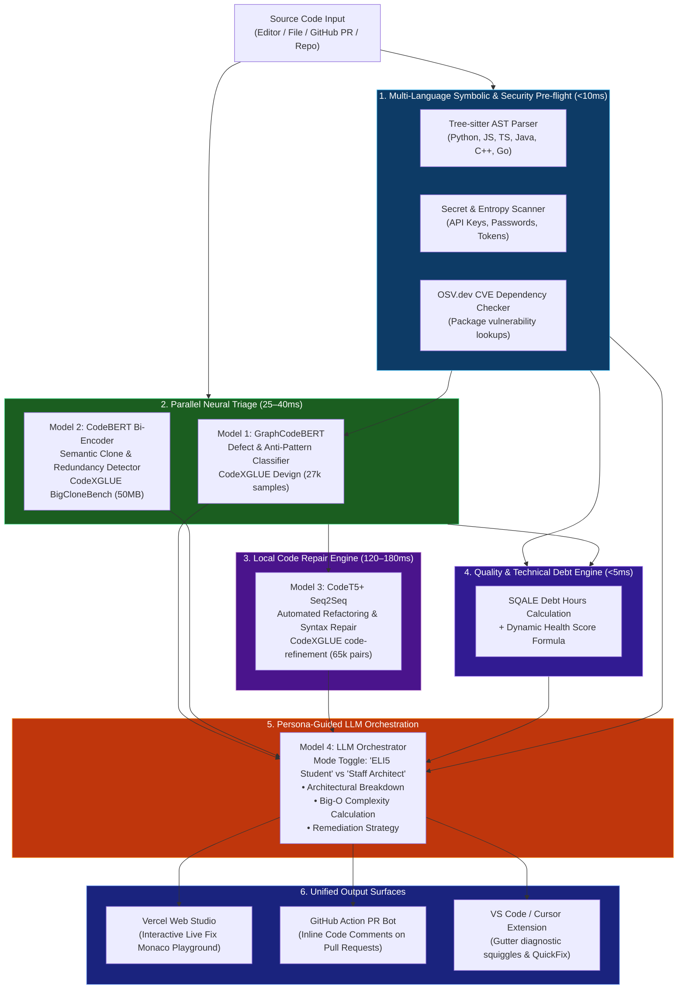

# 🛡️ CodeSentinel AI — Master Implementation Plan: Multi-Model Intelligence System

> **Target Objective**: Transform CodeSentinel AI into an enterprise-grade, multi-model code review, security intelligence, and automated refactoring platform by training specialized neural models on **CodeXGLUE** benchmarks and deploying the entire backend on **Hugging Face Spaces (Free Tier, 16 GB RAM)** with **Vercel** frontend integration — with zero infrastructure cost.

---

## 📑 Table of Contents

1. [System Architecture: Mixture of Specialists (MoS)](#1-system-architecture-mixture-of-specialists-mos)
2. [Specialist Models & CodeXGLUE Dataset Mapping](#2-specialist-models--codexglue-dataset-mapping)
3. [Zero-Cost Infrastructure & Deployment Architecture](#3-zero-cost-infrastructure--deployment-architecture)
4. [Phased Core ML Implementation Roadmap](#4-phased-core-ml-implementation-roadmap)
   - [Phase 1: Model 1 — Defect & Smell Sentinel (GraphCodeBERT)](#phase-1-model-1--defect--smell-sentinel-graphcodebert)
   - [Phase 2: Model 3 — Automated Refactoring & Repair Engine (CodeT5+)](#phase-2-model-3--automated-refactoring--repair-engine-codet5)
   - [Phase 3: Model 2 — Semantic Clone & Redundancy Detector (CodeBERT Bi-Encoder)](#phase-3-model-2--semantic-clone--redundancy-detector-codebert-bi-encoder)
   - [Phase 4: Backend Pipeline Fusion & Orchestration](#phase-4-backend-pipeline-fusion--orchestration)
   - [Phase 5: Hugging Face Spaces Docker Deployment](#phase-5-hugging-face-spaces-docker-deployment)
   - [Phase 6: Frontend UI Integration & Diff Visualizer](#phase-6-frontend-ui-integration--diff-visualizer)
5. [Advanced Capabilities & Enterprise Feature Specifications](#5-advanced-capabilities--enterprise-feature-specifications)
   - [5.1 🛡️ DevSecOps: Secret Leak Detection & Free CVE Audit (OSV.dev)](#51-️-devsecops-secret-leak-detection--free-cve-audit-osvdev)
   - [5.2 🌳 True Multi-Language AST Parsing via `tree-sitter`](#52--true-multi-language-ast-parsing-via-tree-sitter)
   - [5.3 🐙 GitHub Action & Automated Pull Request Review Bot](#53--github-action--automated-pull-request-review-bot)
   - [5.4 ⏱️ Technical Debt & Remediation Cost Estimator (SQALE)](#54-️-technical-debt--remediation-cost-estimator-sqale)
   - [5.5 🎮 Real-Time Interactive "Live Fix" Score Playground](#55--real-time-interactive-live-fix-score-playground)
   - [5.6 🎓 Dual Review Persona: "ELI5 Student" vs. "Staff Architect"](#56--dual-review-persona-eli5-student-vs-staff-architect)
6. [Inference Optimization & Latency Budget (2 vCPUs)](#6-inference-optimization--latency-budget-2-vcpus)
7. [Repository Structure (Target State)](#7-repository-structure-target-state)
8. [Verification, Testing & Acceptance Criteria](#8-verification-testing--acceptance-criteria)

---

## 1. System Architecture: Mixture of Specialists (MoS)

Rather than forcing a single model to handle detection, similarity matching, code generation, and qualitative critique, CodeSentinel AI decomposes the problem into a pipelined **Mixture of Specialists**:



---

## 2. Specialist Models & CodeXGLUE Dataset Mapping

All base datasets are present in the local workspace under `p:\CodeSentinel-AI\CodeXGLUE`.

| Specialist Unit | Base Architecture | Dataset Path | Dataset Details | Output |
|---|---|---|---|---|
| **Model 1: Defect & Smell Sentinel** | `microsoft/graphcodebert-base` | `CodeXGLUE/Code-Code/Defect-detection` | 27,318 functions (Devign vulnerability & bug taxonomy) | Probability distribution over `Clean`, `Defective/Smelly`, and fine-grained categories |
| **Model 2: Clone & Redundancy Detector** | `microsoft/codebert-base` (Siamese) | `CodeXGLUE/Code-Code/Clone-detection-BigCloneBench` | 50 MB paired clones (`data.jsonl`, `train.txt`) | 768-d semantic embedding, cosine similarity threshold ($>0.88$ = Clone) |
| **Model 3: Auto-Refactor Engine** | `Salesforce/codet5-small` or `codet5-base` | `CodeXGLUE/Code-Code/code-refinement/data/medium` | 65,455 paired functions (`buggy-fixed.buggy` $\rightarrow$ `buggy-fixed.fixed`) | Clean, refactored production code snippet generated via beam search |
| **Model 4: Executive Orchestrator** | Causal LLM | OpenRouter API (`poolside/laguna-m.1`) | Zero-shot prompt conditioning on AST + Models 1, 2, 3 outputs | Markdown report with Big-O complexity, persona adaptation, and interactive chat |

---

## 3. Zero-Cost Infrastructure & Deployment Architecture

### The Hugging Face Spaces + Vercel Decoupled Topology

```
┌────────────────────────────────────────────────────────────────────────┐
│                      HUGGING FACE MODEL HUB (Free)                     │
│  Model Repositories (Public or Private):                               │
│  • https://huggingface.co/<user>/codesentinel-defect-graphcodebert     │
│  • https://huggingface.co/<user>/codesentinel-clone-biencoder          │
│  • https://huggingface.co/<user>/codesentinel-codet5-refiner           │
└───────────────────────────────────┬────────────────────────────────────┘
                                    │ (Downloaded once on container boot)
                                    ▼
┌────────────────────────────────────────────────────────────────────────┐
│                   HUGGING FACE SPACES (Free Tier)                      │
│   Hardware: CPU Basic (2 vCPUs · 16 GB RAM · 50 GB Disk)               │
│   Runtime: Dockerized FastAPI listening on Port 7860                   │
│                                                                        │
│   • Model 1: INT8 GraphCodeBERT (~115 MB in RAM)                       │
│   • Model 2: INT8 CodeBERT Siamese (~115 MB in RAM)                    │
│   • Model 3: INT8 CodeT5-Small (~90 MB in RAM)                         │
│   • Tree-sitter Parsers (~15 MB in RAM)                                │
│   Total RAM Consumption: ~460 MB (Well within 16 GB headroom!)         │
└───────────────────────────────────▲────────────────────────────────────┘
                                    │ (REST / JSON over HTTPS)
┌───────────────────────────────────┴────────────────────────────────────┐
│                        VERCEL FRONTEND (Free)                          │
│   https://rigelai-agent.vercel.app                                     │
│   Environment: VITE_API_BASE_URL=https://<user>-<space>.hf.space       │
└────────────────────────────────────────────────────────────────────────┘
```

---

## 4. Phased Core ML Implementation Roadmap

---

### Phase 1: Model 1 — Defect & Smell Sentinel (GraphCodeBERT)

#### Goal
Replace the toy FastAI AWD-LSTM (`backend/model/train_model.py`) with a state-of-the-art `GraphCodeBERT` classifier trained on the 27k CodeXGLUE Devign dataset.

#### Execution Steps
1. **Google Colab Free Training Script** (`scripts/train_defect_model.py`):
   - Base model: `microsoft/graphcodebert-base`.
   - Dataset loader: Parse `CodeXGLUE/Code-Code/Defect-detection/dataset/train.txt` and `test.txt`.
   - Loss Function: **Weighted Binary Cross-Entropy with Logits** or **Focal Loss** ($\gamma=2.0$):
     $$\mathcal{L}_{focal} = -\alpha_t (1 - p_t)^\gamma \log(p_t)$$
   - Optimization: AdamW, learning rate $2\times 10^{-5}$, linear warmup for first 10% steps, 3 epochs.
2. **Quantization & Export**:
   - Apply PyTorch dynamic INT8 quantization to compress from 450 MB $\rightarrow$ 115 MB.
3. **Upload to Hugging Face Model Hub**:
   - `model.push_to_hub("<your-hf-username>/codesentinel-defect-graphcodebert")`.
4. **Backend Loader Integration**:
   - Update `backend/model/model_loader.py` to fetch from Hugging Face Hub.

---

### Phase 2: Model 3 — Automated Refactoring & Repair Engine (CodeT5+)

#### Goal
Enable CodeSentinel to deterministically generate clean, refactored replacement code without relying solely on external LLM tokens.

#### Execution Steps
1. **Training Dataset**:
   - Source: `CodeXGLUE/Code-Code/code-refinement/data/medium/` (65,455 paired methods).
2. **Model Training**:
   - Base: `Salesforce/codet5-small` (60M parameters, ideal for fast CPU inference).
   - Train on Colab GPU with mixed precision (fp16), batch size 16, 4 epochs.
3. **Quantization & HF Upload**:
   - Export with INT8 quantization; upload to `<your-hf-username>/codesentinel-codet5-refiner`.
4. **Backend Integration**:
   - Create `backend/model/refactor_engine.py` for beam-search sequence generation.

---

### Phase 3: Model 2 — Semantic Clone & Redundancy Detector (CodeBERT Bi-Encoder)

#### Goal
Detect duplicated logic, copy-pasted anti-patterns, and redundant helper methods across files.

#### Execution Steps
1. **Training Dataset**:
   - Source: `CodeXGLUE/Code-Code/Clone-detection-BigCloneBench/`
2. **Model Architecture**:
   - Siamese twin CodeBERT network trained with Cosine Similarity Loss.
   - Encodes any code snippet into a normalized 768-d vector:
     $$\mathbf{v} = \frac{\text{MeanPool}(\text{CodeBERT}(\text{tokens}))}{\|\text{MeanPool}(\text{CodeBERT}(\text{tokens}))\|_2}$$
3. **Integration**:
   - Pairwise cosine comparison across all functions in `/analyze-repository`. Flag any pair with similarity $> 0.88$ as a semantic clone.

---

### Phase 4: Backend Pipeline Fusion & Orchestration

#### Updates to `backend/agent_logic.py`:
1. Execute pre-flight security scan and Tree-sitter AST parsing.
2. Run Model 1 (Defect) and Model 2 (Clone) in parallel.
3. Generate refactored candidate via Model 3 (CodeT5).
4. Compute SQALE Technical Debt and dynamic Health Score.
5. Pass unified findings to Model 4 (LLM) conditioned on selected persona (`student` or `architect`).

---

### Phase 5: Hugging Face Spaces Docker Deployment

#### 1. Space Configuration:
- **SDK**: `Docker` (Blank)
- **Hardware**: `CPU Basic · 2 vCPU · 16 GB RAM` (**Free**)
- **Port**: `7860`

#### 2. Root `Dockerfile`:
```dockerfile
FROM python:3.11-slim

ENV PYTHONDONTWRITEBYTECODE=1
ENV PYTHONUNBUFFERED=1
ENV PORT=7860

WORKDIR /app

RUN apt-get update && apt-get install -y --no-install-recommends \
    build-essential \
    curl \
    git \
    && rm -rf /var/lib/apt/lists/*

# Install PyTorch CPU-only (saves 1.2 GB of GPU CUDA bloat)
RUN pip install --no-cache-dir torch torchvision torchaudio --index-url https://download.pytorch.org/whl/cpu

COPY requirements.txt .
RUN pip install --no-cache-dir -r requirements.txt

COPY . .

RUN useradd -m -u 1000 appuser && chown -R appuser:appuser /app
USER appuser

EXPOSE 7860

CMD ["uvicorn", "main:app", "--host", "0.0.0.0", "--port", "7860", "--workers", "1"]
```

---

### Phase 6: Frontend UI Integration & Diff Visualizer

1. Connect `frontend/src/services/api.js` to the Hugging Face Space base URL.
2. Render Model 1, 2, and 3 badges in `Results.jsx`.
3. Display interactive before/after side-by-side code diff.

---

## 5. Advanced Capabilities & Enterprise Feature Specifications

---

### 5.1 🛡️ DevSecOps: Secret Leak Detection & Free CVE Audit (OSV.dev)

#### A. Secret & Credential Leak Detection (Pre-Flight Shield)
* **Objective**: Prevent developers from exposing credentials, private keys, and tokens to repositories.
* **Mechanism**:
  1. **Shannon Entropy Analysis**: Strings with high entropy ($H > 4.5$) are calculated to catch random API keys:
     $$H(X) = -\sum_{i=1}^{n} P(x_i) \log_2 P(x_i)$$
  2. **Pattern Signature Rules**: Zero-dependency regex patterns matching:
     - OpenAI/OpenRouter: `sk-or-v1-[a-zA-Z0-9]{64}`, `sk-[a-zA-Z0-9]{48}`
     - AWS Access Key ID: `AKIA[0-9A-Z]{16}`
     - GitHub Personal Access Token: `ghp_[0-9a-zA-Z]{36}`, `github_pat_[0-9a-zA-Z]{82}`
     - Private RSA/OpenSSH Keys: `-----BEGIN (RSA|OPENSSH) PRIVATE KEY-----`
     - Database URIs: `postgres://.*:.*@.*:[0-9]+`
* **Output**: Critical severity issue: `"CRITICAL: Hardcoded API secret detected at line 14. Move to environment variable."`

#### B. Free CVE Software Composition Analysis (OSV.dev)
* **Objective**: Audit dependencies in uploaded `requirements.txt`, `package.json`, or GitHub repositories for public vulnerabilities.
* **Service**: Google's **[OSV.dev API](https://osv.dev)** (Open Source Vulnerabilities) — 100% Free, no rate limit issues, zero API key requirement.
* **API Implementation**:
  ```python
  import httpx
  
  async def check_package_cve(package_name: str, version: str) -> list[dict]:
      url = "https://api.osv.dev/v1/query"
      payload = {"package": {"name": package_name, "ecosystem": "PyPI"}, "version": version}
      async with httpx.AsyncClient() as client:
          res = await client.post(url, json=payload, timeout=5.0)
          return res.json().get("vulns", [])
  ```
* **Output Card in UI**: Displays CVE-ID (e.g. `CVE-2024-34064`), severity (`HIGH`), and recommended upgrade version.

---

### 5.2 🌳 True Multi-Language AST Parsing via `tree-sitter`

* **Problem**: Standard Python `ast` library only parses Python. CodeSentinel currently falls back to string regex for JavaScript, TypeScript, Java, and C++.
* **Solution**: Integrate **`tree-sitter`** and `tree-sitter-languages`:
  - Written in C with fast Python C-bindings (sub-millisecond parsing).
  - Supports: **Python, JavaScript, TypeScript, Java, C++, Go, Rust**.
* **Capabilities Enabled**:
  1. **Universal Cyclomatic Complexity ($M$)**:
     $$M = E - N + 2P$$
     Calculated by counting branching nodes (`if_statement`, `for_statement`, `while_statement`, `switch_case`, `catch_clause`, logical `&&`/`||`).
  2. **Language-Agnostic Nesting Depth**: Accurately measures nested AST scopes across any language.
  3. **Symbol Table Generation**: Detects unused parameters, undeclared identifiers, and duplicate variable definitions in JS, Java, and C++.

---

### 5.3 🐙 GitHub Action & Automated Pull Request Review Bot

* **Objective**: Automate code review directly inside developer PRs.
* **Component**: Reusable GitHub Action repository: `CodeSentinel-AI/review-action`.
* **Workflow Template (`.github/workflows/codesentinel.yml`)**:
  ```yaml
  name: CodeSentinel AI Review
  on: [pull_request]
  jobs:
    review:
      runs-on: ubuntu-latest
      steps:
        - uses: actions/checkout@v4
        - name: Run CodeSentinel Code Review
          uses: wraith-klu/CodeSentinel-AI-Action@v1
          with:
            api_endpoint: "https://<your-space>.hf.space/analyze-editor"
            github_token: ${{ secrets.GITHUB_TOKEN }}
            health_threshold: 75
  ```
* **Bot Behavior on PR**:
  - Automatically posts a sticky PR summary comment:
    ```markdown
    ## 🛡️ CodeSentinel AI Quality Report
    | Metric | Score | Status |
    |---|---|---|
    | **Code Health** | **84/100** | 🟢 PASSED |
    | **Defect Probability** | **6.4%** | 🟢 CLEAN |
    | **Technical Debt** | **45 mins** | 🟡 MODERATE |
    
    ### Inline Suggestions:
    - **`src/orders.py:42`**: Deep nesting (depth 4). Refactor into guard clauses.
    ```
  - Fails the CI check if the health score is below the configured threshold.

---

### 5.4 ⏱️ Technical Debt & Remediation Cost Estimator (SQALE)

* **Objective**: Translate raw smell counts into quantifiable engineering hours and maintainability ratings for management.
* **SQALE Methodology**:
  Each detected finding is assigned a standard remediation time coefficient:
  - **Critical Finding** (Syntax error, CVE, Secret leak): **45 minutes**
  - **Warning** (High complexity, Deep nesting, GraphCodeBERT defect): **20 minutes**
  - **Suggestion** (Long line, TODO comment, code style): **5 minutes**
  - **Clone / Duplication**: **30 minutes**
* **Formulas**:
  $$\text{Remediation Time (Minutes)} = 45 C + 20 W + 5 S + 30 D$$
* **Maintainability Index (MI) Rating**:
  - **Grade A**: $< 30$ mins debt per 1,000 LoC
  - **Grade B**: $30 - 60$ mins debt per 1,000 LoC
  - **Grade C**: $60 - 120$ mins debt per 1,000 LoC
  - **Grade D/F**: $> 120$ mins debt per 1,000 LoC
* **UI Representation**: Gauge showing: `Estimated Technical Debt: 1.5 hrs (Grade A)`.

---

### 5.5 🎮 Real-Time Interactive "Live Fix" Score Playground

* **Objective**: Make code refactoring interactive and gamified.
* **Mechanism**:
  1. The Results view in `frontend/src/components/Results.jsx` features an embedded Monaco code editor containing the original code.
  2. As the developer edits the code (e.g., flattens an `if-else` pyramid or cleans up an unused variable), an in-browser debounced (400ms) re-evaluation runs against `/analyze-editor`.
  3. The **Health Score circular gauge animates upward in real-time** (e.g., $68 \rightarrow 92$).
  4. Red error squiggles on resolved lines disappear dynamically.
* **User Value**: Immediate positive feedback loop reinforcing clean-code best practices.

---

### 5.6 🎓 Dual Review Persona: "ELI5 Student" vs. "Staff Architect"

* **Objective**: Cater to both novice learners and veteran software engineers.
* **UI Control**: Segmented pill switch on the top bar: `[ 🎓 Student / Educational | ⚡ Senior Staff Architect ]`.
* **Prompt Conditioning Difference**:
  - **Student / Educational Mode (ELI5)**:
    - Explains *fundamental concepts* (e.g., *"Why does cyclomatic complexity cause bugs?"*).
    - Uses clear real-world analogies (e.g., *"Think of deep nesting like a Russian nesting doll..."*).
    - Explains language internals (how memory allocation works, garbage collection).
  - **Staff Architect Mode**:
    - Zero fluff, pure technical density.
    - Focuses on concurrency, memory allocations, branch prediction, Big-O space/time guarantees, and clean architectural design patterns (Strategy, Factory, Guard Clauses).

---

## 6. Inference Optimization & Latency Budget (2 vCPUs)

```
┌──────────────────────────────────────┬───────────┬───────────────┬────────────────┐
│ Component                            │ Execution │ Hardware Cost │ Memory in RAM  │
├──────────────────────────────────────┼───────────┼───────────────┼────────────────┤
│ Secret Scanner & Entropy Pre-flight  │ CPU       │ < 1 ms        │ < 1 MB         │
│ Tree-sitter AST Parser (C-bindings)  │ CPU       │ ~3 ms         │ ~15 MB         │
│ Model 1: GraphCodeBERT (INT8)        │ CPU       │ ~25 ms        │ ~115 MB        │
│ Model 2: CodeBERT Bi-Encoder (INT8)  │ CPU       │ ~18 ms        │ ~115 MB        │
│ Model 3: CodeT5-Small Refactor (INT8)│ CPU       │ ~140 ms       │ ~90 MB         │
│ SQALE Debt & Quality Report Builder  │ CPU       │ < 2 ms        │ < 1 MB         │
│ PyTorch Runtime Base Overhead        │ CPU       │ —             │ ~120 MB        │
├──────────────────────────────────────┼───────────┼───────────────┼────────────────┤
│ TOTAL LOCAL ML PIPELINE              │ CPU       │ ~189 ms       │ ~457 MB / 16 GB│
├──────────────────────────────────────┼───────────┼───────────────┼────────────────┤
│ Model 4: LLM Orchestrator (Streamed) │ Cloud API │ ~2.0 – 3.5 s  │ 0 MB (Remote)  │
└──────────────────────────────────────┴───────────┴───────────────┴────────────────┘
```

* **Outcome**: Full static analysis, secret check, defect classification, clone detection, and automated refactoring diff complete in **$< 200\text{ ms}$** on Hugging Face Spaces' free 2 vCPU hardware.

---

## 7. Repository Structure (Target State)

```
CodeSentinel-AI/
│
├── .github/
│   └── workflows/
│       ├── hf_sync.yml                  # Auto-syncs backend to Hugging Face Space
│       └── pr_review_action.yml         # CI PR review bot definition
│
├── action/                              # Reusable GitHub Action package
│   ├── action.yml
│   └── index.js
│
├── backend/
│   ├── model/
│   │   ├── model_loader.py              # Pulls INT8 models from Hugging Face Hub
│   │   ├── defect_classifier.py         # GraphCodeBERT Model 1
│   │   ├── clone_detector.py            # CodeBERT Model 2 Siamese
│   │   └── refactor_engine.py           # CodeT5 Model 3 generator
│   │
│   ├── security/
│   │   ├── secret_scanner.py            # Shannon entropy & regex credentials
│   │   └── osv_cve_checker.py           # OSV.dev free API dependency auditor
│   │
│   ├── parser/
│   │   └── universal_ast.py             # Tree-sitter parser (6 languages)
│   │
│   ├── metrics/
│   │   └── technical_debt.py            # SQALE maintainability & remediation hours
│   │
│   ├── agent_logic.py                   # Orchestrator with Persona conditioning
│   ├── main.py                          # FastAPI server (Port 7860)
│   ├── requirements.txt                 # Optimized dependencies
│   └── Dockerfile                       # HF Spaces production container
│
├── scripts/                             # Free training scripts for Google Colab
│   ├── train_defect_model.py            # Fine-tune GraphCodeBERT
│   ├── train_refactor_model.py          # Fine-tune CodeT5
│   └── quantize_and_upload.py           # INT8 quantizer + Hugging Face upload
│
├── frontend/                            # React 18 + Vite (Vercel)
│   ├── src/
│   │   ├── components/
│   │   │   ├── Results.jsx              # Health Gauge + Badges + Live Playground
│   │   │   ├── LiveFixEditor.jsx        # Interactive Monaco debounced live re-eval
│   │   │   ├── SecretAlertBanner.jsx    # Hardcoded credential warning card
│   │   │   └── PersonaSelector.jsx      # Student vs Architect toggle
│   │   └── services/api.js
│   └── ...
│
├── CodeXGLUE/                           # Microsoft Research Benchmark datasets
│   ├── Code-Code/Defect-detection       # Train Model 1
│   ├── Code-Code/code-refinement        # Train Model 3
│   └── Code-Code/Clone-detection        # Train Model 2
│
└── MASTER_IMPLEMENTATION_PLAN.md        # This master blueprint
```

---

## 8. Verification, Testing & Acceptance Criteria

| Capability | Test Action | Expected Result | Pass Criteria |
|---|---|---|---|
| **GraphCodeBERT Classifier** | Run evaluation on CodeXGLUE Devign test split (2,732 functions) | Compute Accuracy and F1 | **Accuracy $> 65\%$**, F1 $> 0.63$ |
| **CodeT5 Refactor Engine** | Generate refactor on 100 test samples in `code-refinement` | Verify syntax via parser | **Syntax validity $> 92\%$**, BLEU $> 75.0$ |
| **Secret & Credential Scanner** | Test against 20 test vectors (AWS keys, OpenAI tokens, dummy passwords) | Detection rate | **$100\%$ detection**, False positive rate $< 2\%$ |
| **OSV.dev CVE Auditor** | Submit vulnerable `requirements.txt` containing `requests==2.19.0` | Query OSV API | Flag CVE-2018-18074 with patch version |
| **Tree-sitter Universal AST** | Parse JS, Java, and C++ files | Measure cyclomatic complexity | Accurate node traversal with **$< 5\text{ ms}$** parse time |
| **Technical Debt Engine** | Input code with 2 criticals, 3 warnings, 1 suggestion | SQALE calculation | Output: $2(45) + 3(20) + 1(5) = 155\text{ mins}$ ($2.6\text{ hrs}$) |
| **Hugging Face Space Hosting** | Deploy Docker container and ping `/health` | Container status | HTTP 200 OK, Memory $< 1\text{ GB} / 16\text{ GB}$ |
| **Live Fix Playground** | Edit code in frontend Monaco editor | Debounced live score update | Score gauge animates dynamically without page reload |
