<div align="center">

# 🛡️ CodeSentinel AI
### AI-Powered Code Analysis Platform
#### AST &nbsp;·&nbsp; Machine Learning &nbsp;·&nbsp; LLM &nbsp;—&nbsp; Detect &nbsp;|&nbsp; Analyze &nbsp;|&nbsp; Optimize

<br/>

[](https://rigelai-agent.vercel.app/)
[](https://rigelai.onrender.com/)
[](https://python.org)
[](https://fastapi.tiangolo.com/)
[](https://react.dev/)
[](https://docs.fast.ai/)
[](LICENSE)

<br/>

> **CodeSentinel AI** is an intelligent, multi-layered code analysis platform that fuses **AST static analysis**, **AWD-LSTM machine learning**, and **Large Language Model reasoning** to detect code smells, assess code health, and generate optimized refactors — in real time.

</div>

---

## 📋 Table of Contents

- [✨ Features](#-features)
- [🏗️ System Architecture](#️-system-architecture)
- [🤖 ML Pipeline — Deep Dive](#-ml-pipeline--deep-dive)
  - [Layer 1 — AST Static Analysis](#-layer-1--ast-static-analysis-engine)
  - [Layer 2 — AWD-LSTM Classifier](#-layer-2--awd-lstm-ml-classifier)
  - [Layer 3 — LLM Reasoning Engine](#-layer-3--llm-reasoning-engine)
  - [Health Score Algorithm](#-health-score-algorithm)
- [🔬 End-to-End Request Flow](#-end-to-end-request-flow)
- [📊 Training Data & Model](#-training-data--model-details)
- [🚀 API Endpoints](#-api-endpoints)
- [🗂️ Project Structure](#️-project-structure)
- [⚙️ Tech Stack](#️-tech-stack)
- [🛠️ Local Setup](#️-local-setup)
- [👨‍💻 Author & License](#-author--license)

---

## ✨ Features

| Feature | Description |
|---|---|
| 🌳 **AST Analysis** | Parses code into an Abstract Syntax Tree — detects deep nesting, long functions, unused variables |
| 🧠 **ML Code Smell Classifier** | AWD-LSTM model trained on labeled code snippets; classifies as **Clean** or **Smelly** with confidence |
| 🤖 **LLM Code Review** | GPT-class LLM via OpenRouter delivers executive summary, Big-O analysis, and a step-by-step refactor plan |
| 🔢 **Health Score Engine** | Deterministic weighted formula — `100 − (critical×25 + warning×12 + suggestion×6)` |
| 💬 **Multi-Turn Chat** | Session-based follow-up questions anchored to the same code context |
| 📁 **File Upload** | Supports `.py .java .cpp .c .js .ts .go .rs .php .rb .jsx .tsx` |
| 🐙 **GitHub Repo Scan** | Fetches up to 12 source files from any public repo via GitHub API |
| 📄 **PDF Export** | Download full AI discussion as a formatted PDF via ReportLab |
| 🔌 **VS Code Extension** | Inline code review directly inside your editor |

---

## 🏗️ System Architecture

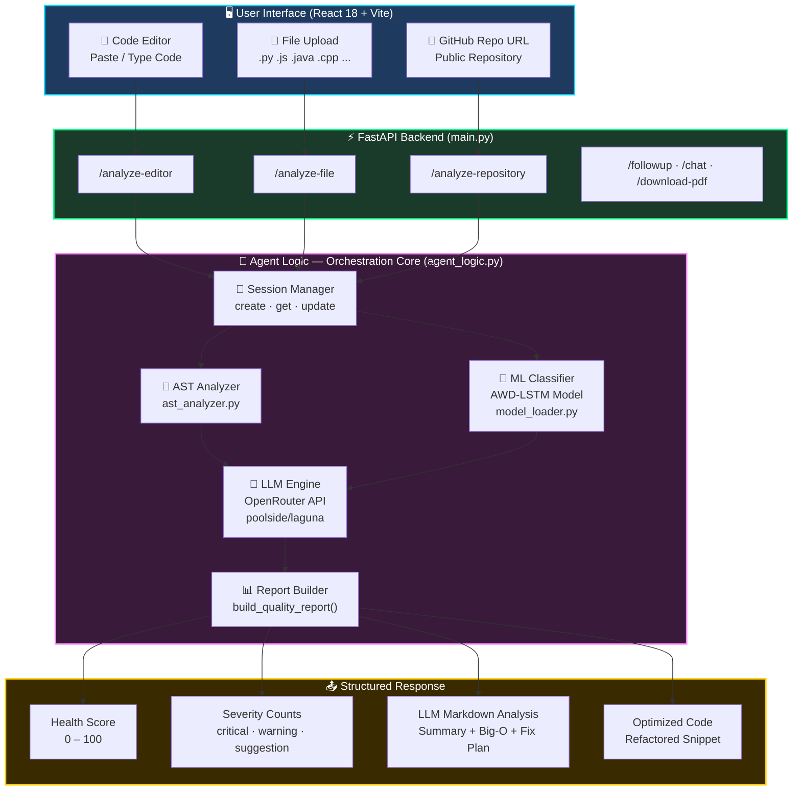

---

## 🤖 ML Pipeline — Deep Dive

CodeSentinel AI uses a **3-layer intelligent analysis pipeline**. Each layer adds progressively deeper insight.

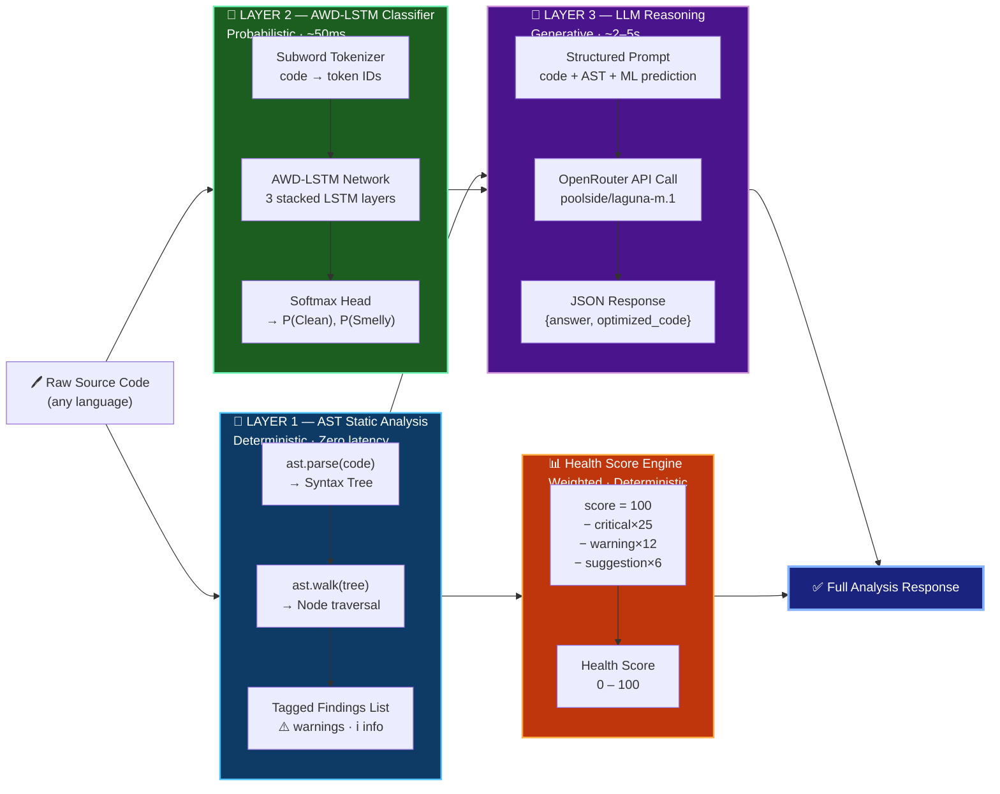

---

### 🌳 Layer 1 — AST Static Analysis Engine

> **File:** [`backend/ast_analyzer.py`](backend/ast_analyzer.py)

The AST layer is the **fastest, most precise** detector. It parses source code into a tree and inspects every single node.

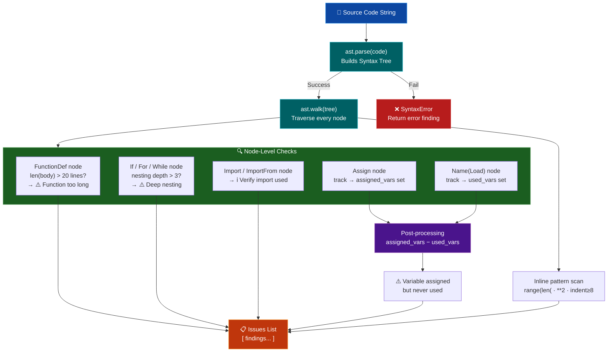

#### Detection Rules Reference

| # | Node Type | Condition | Severity | Output Message |
|---|---|---|---|---|
| 1 | `FunctionDef` | `len(body) > 20` | ⚠️ Warning | Function `'name'` is too long — consider refactoring |
| 2 | `If / For / While` | `depth > 3` | ⚠️ Warning | Deep nesting detected (depth N) |
| 3 | `Import` | Always | ℹ️ Info | Imported module `'x'` — ensure it's used |
| 4 | `ImportFrom` | Always | ℹ️ Info | From-import `'module'` — verify names used |
| 5 | `Assign` vs `Name(Load)` | assigned − used ≠ ∅ | ⚠️ Warning | Variable `'x'` assigned but never used |
| 6 | Line length | `len(line) > 100` | 💡 Suggestion | Line longer than 100 characters |
| 7 | Comment marker | `"TODO" in line` | 💡 Suggestion | Unresolved TODO present |
| 8 | Pattern match | `"range(len("` in code | ⚠️ Warning | Inefficient loop using `range(len(...))` |
| 9 | Indentation | `indent >= 8 + "if "` | ⚠️ Warning | Deep nesting at line N |

---

### 🧠 Layer 2 — AWD-LSTM ML Classifier

> **Files:** [`backend/model/train_model.py`](backend/model/train_model.py) · [`backend/model/model_loader.py`](backend/model/model_loader.py)

The ML layer treats **source code as natural language text** and classifies it using the **AWD-LSTM** architecture (ASGD Weight-Dropped LSTM) via FastAI.

#### Network Architecture

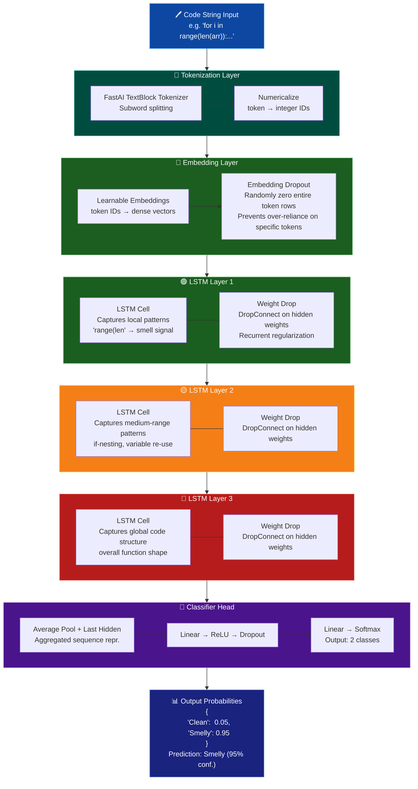

#### AWD-LSTM Key Innovations

| Technique | What It Does | Benefit |
|---|---|---|
| **Weight Drop** | Applies dropout to LSTM recurrent weight matrices | Prevents co-adaptation; acts as recurrent regularization |
| **Embedding Dropout** | Zeros entire embedding rows at random | Forces robustness to unseen/rare tokens |
| **ASGD Optimizer** | Averages model weights across recent steps | More stable convergence than plain SGD/Adam |
| **Variable-length BPTT** | Randomizes backprop sequence length | Better gradient flow through long code sequences |
| **Gradual Unfreezing** | Unfreezes layers one-by-one during fine_tune | Preserves pre-trained language representations |

#### Training Pipeline

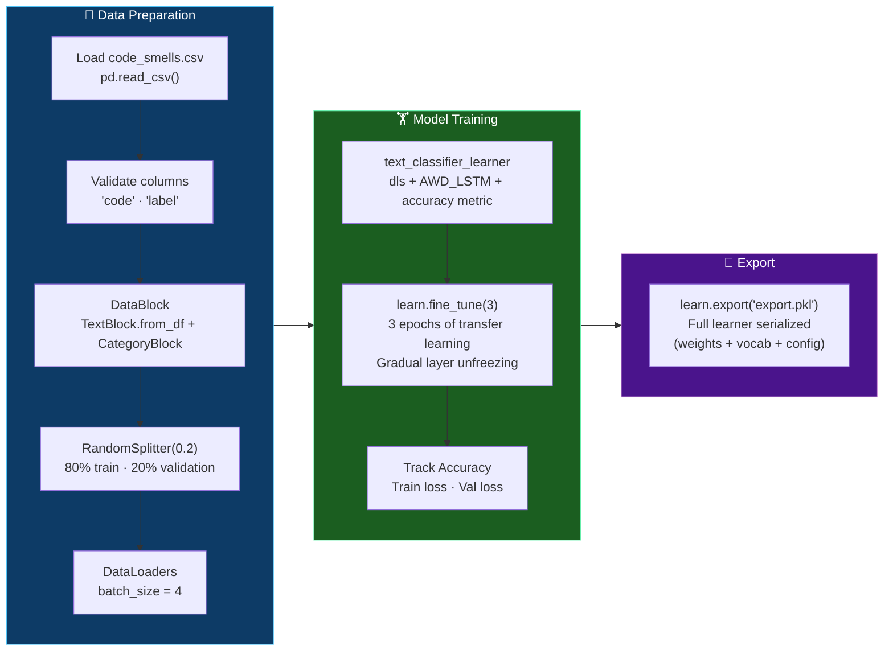

#### Inference Flow

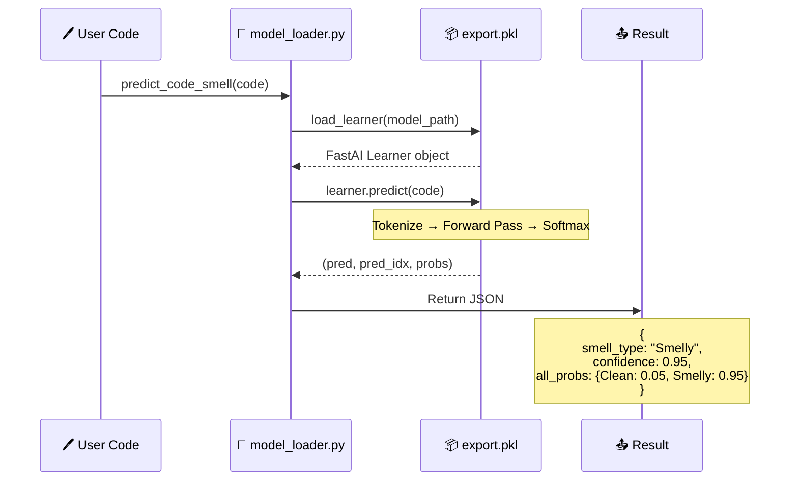

---

### 💬 Layer 3 — LLM Reasoning Engine

> **File:** [`backend/agent_logic.py`](backend/agent_logic.py)

The LLM receives a **structured multi-context prompt** combining the code, AST findings, and ML prediction, then returns a rich structured JSON response.

#### Prompt Construction Flow

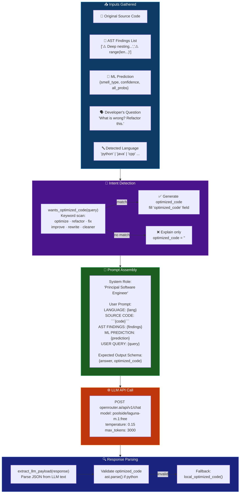

#### LLM Response Structure

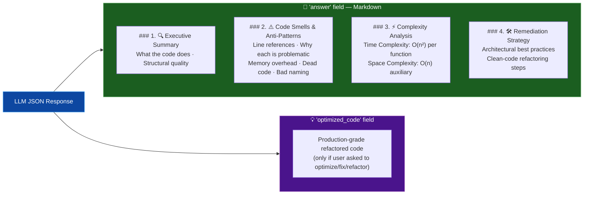

#### Language Detection Algorithm

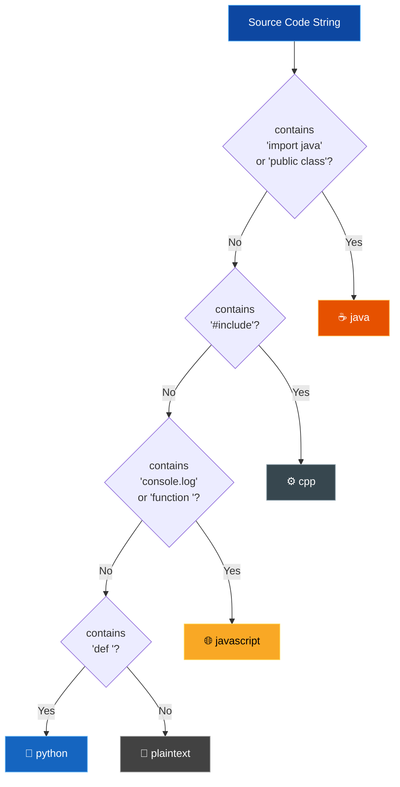

---

### 📊 Health Score Algorithm

> **File:** [`backend/agent_logic.py → build_quality_report()`](backend/agent_logic.py)

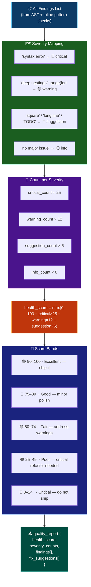

**Severity weights at a glance:**

| Severity | Weight | Meaning | Max impact |
|---|---|---|---|
| 🔴 **Critical** | `−25` | Syntax errors, catastrophic bugs | 4 criticals → score 0 |
| 🟡 **Warning** | `−12` | Code smells, deep nesting, bad loops | 8 warnings → score 4 |
| 🔵 **Suggestion** | `−6` | Long lines, TODOs, style issues | 16 suggestions → score 4 |
| ⚪ **Info** | `0` | Informational notes only | No penalty |

---

## 🔬 End-to-End Request Flow

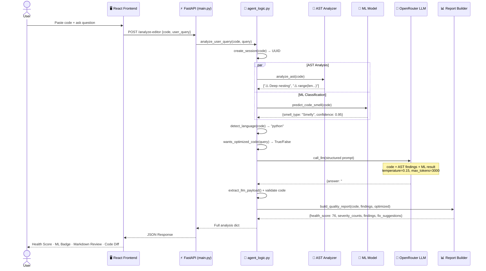

---

## 📊 Training Data & Model Details

### Dataset: [`backend/model/code_smells.csv`](backend/model/code_smells.csv)

The AWD-LSTM is trained on labeled Python code snippet pairs — one **Smelly** version and one **Clean** version of the same pattern:

| Smelly Code | Clean Code | Smell Type |
|---|---|---|
| `for i in range(len(arr)): print(arr[i])` | `for x in arr: print(x)` | Inefficient index loop |
| `if x == True: print('ok')` | `if x: print('ok')` | Redundant bool comparison |
| `try: x=1/0\nexcept: pass` | `try:\n  x=1/0\nexcept ZeroDivisionError:\n  print('error')` | Bare except clause |
| `print('debug')` | `logging.info('Task completed')` | Debug print in production |
| `for i in range(0, len(data)): process(data[i])` | `for item in data: process(item)` | Index-based iteration |
| `if flag == False: return` | `if not flag: return` | Explicit False comparison |
| `x = 10\nx = 20` | `x = 10\ny = 20` | Immediate variable overwrite |
| `def calc(): return None` | `def calc(a,b): return a+b` | Meaningless function |

### Model Specification

| Property | Value |
|---|---|
| Architecture | AWD-LSTM (3 stacked LSTM layers with Weight Drop) |
| Framework | FastAI `text_classifier_learner` |
| Backend | PyTorch |
| Tokenizer | FastAI `TextBlock` subword tokenizer |
| Train / Validation split | 80% / 20% — `RandomSplitter(valid_pct=0.2)` |
| Batch size | 4 |
| Fine-tune epochs | 3 (`learn.fine_tune(3)`) |
| Optimizer | ASGD (Averaged Stochastic Gradient Descent) |
| Metric | Accuracy |
| Output classes | `["Clean", "Smelly"]` |
| Export format | `export.pkl` — full FastAI serialized learner |

---

## 🚀 API Endpoints

**Base URL:** `https://rigelai.onrender.com`

| Method | Endpoint | Payload | Description |
|---|---|---|---|
| `GET` | `/` | — | Root health ping |
| `GET` | `/health` | — | Status check |
| `POST` | `/analyze-editor` | `{code, user_query, session_id?}` | Analyze code from editor input |
| `POST` | `/analyze-file` | `multipart: file + user_query` | Analyze uploaded source file |
| `POST` | `/analyze-repository` | `{repository_url, user_query}` | Scan a public GitHub repository |
| `POST` | `/followup` | `{user_query, session_id}` | Follow-up question in same session |
| `POST` | `/chat` | `{user_query}` | General programming Q&A (no code) |
| `POST` | `/download-pdf` | `{text}` | Export AI discussion as PDF |

**Example — `/analyze-editor`:**

```jsonc
// REQUEST
{
  "code": "for i in range(len(arr)): print(arr[i])",
  "user_query": "What is wrong with this code?",
  "session_id": null
}

// RESPONSE
{
  "llm_analysis": {
    "session_id": "f3a1-...",
    "ast_findings": ["Inefficient loop using range(len(...))"],
    "model_prediction": {
      "smell_type": "Smelly",
      "confidence": 0.95,
      "all_probs": { "Clean": 0.05, "Smelly": 0.95 }
    },
    "llm_response": "### 1. 🔍 Executive Summary\n...",
    "optimized_code": "",
    "language": "python",
    "quality_report": {
      "health_score": 88,
      "severity_counts": { "critical": 0, "warning": 1, "suggestion": 0, "info": 0 },
      "findings": [ /* ... */ ],
      "fix_suggestions": [ /* ... */ ]
    }
  }
}
```

---

## 🗂️ Project Structure

```
CodeSentinel-AI/
│
├── 📁 backend/                          FastAPI Python backend
│   ├── 🐍 main.py                       API server + all route handlers
│   ├── 🧠 agent_logic.py                Core: AST + ML + LLM orchestration
│   ├── 🌳 ast_analyzer.py               Deep AST static analysis
│   ├── 💬 session_store.py              Multi-turn chat session management
│   ├── 📋 requirements.txt              Python dependencies
│   ├── 🔑 .env                          API keys (not committed to git)
│   │
│   ├── 📁 model/                        ML model artefacts
│   │   ├── 📊 code_smells.csv           Labeled training dataset
│   │   ├── 🏋️ train_model.py            AWD-LSTM training script
│   │   └── 🔮 model_loader.py           FastAI inference loader
│   │
│   └── 📁 pdfs/                         Temp-generated PDF exports
│
├── 📁 frontend/                         React + Vite SPA
│   └── 📁 src/
│       ├── 📁 components/
│       │   ├── ⌨️ CodeInputPanel.jsx    Code editor with syntax highlighting
│       │   ├── 💬 Chatbot.jsx           Multi-turn AI chat interface
│       │   ├── 📁 FileUpload.jsx        Drag-and-drop file uploader
│       │   ├── 📊 Results.jsx           Analysis results + health score panel
│       │   └── 🔌 IdeIntegrationModal  VS Code extension setup guide
│       ├── 📁 pages/Home.jsx            Main application page
│       └── 📁 services/api.js           Axios API call wrappers
│
├── 📁 vscode-extension/                 VS Code Extension (VSIX)
│   └── 📁 src/extension.js             Extension activation + commands
│
└── 📄 README.md                         This file
```

---

## ⚙️ Tech Stack

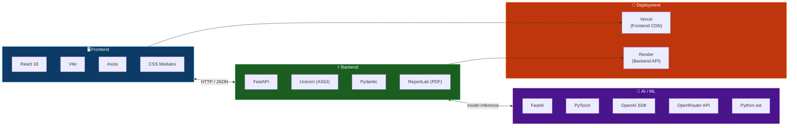

---

## 🛠️ Local Setup

### Prerequisites
- Python **3.11+**
- Node.js **18+**
- [OpenRouter](https://openrouter.ai) API key (free tier available)

### 1 · Clone

```bash
git clone https://github.com/saurabh-yadav/CodeSentinel-AI.git
cd CodeSentinel-AI
```

### 2 · Backend

```bash
cd backend
python -m venv venv
venv\Scripts\activate        # Windows
# source venv/bin/activate   # macOS / Linux

pip install -r requirements.txt
```

Create `backend/.env`:

```env
OPENROUTER_API_KEY=your_openrouter_api_key_here
OPENROUTER_MODEL=poolside/laguna-m.1:free
GITHUB_TOKEN=your_github_token_here   # optional — enables repo scanning
```

Start backend:

```bash
uvicorn main:app --reload --port 8000
```

### 3 · Frontend

```bash
cd frontend
npm install
npm run dev
# App → http://localhost:5173
# API → http://localhost:8000
```

### 4 · Train ML Model *(optional)*

```bash
cd backend/model
python train_model.py
# Produces: export.pkl
```

---

## 👨‍💻 Author & License

**Author**: Saurabh Yadav
**B.Tech CSE** (AI Driven Language Technology) — Koneru Lakshmaiah University
**Portfolio**: [wraithklu.vercel.app](https://wraithklu.vercel.app)

**Repository**: [github.com/saurabh-yadav/CodeSentinel-AI](https://github.com/saurabh-yadav/CodeSentinel-AI)

**License**: This project is open-source software licensed under the **[MIT License](LICENSE)**.

---

<div align="center">

⭐ **If you found CodeSentinel AI useful, please star it on GitHub!** ⭐

[](https://github.com/saurabh-yadav/CodeSentinel-AI)

*Built with ❤️ by Saurabh Yadav*

</div>
